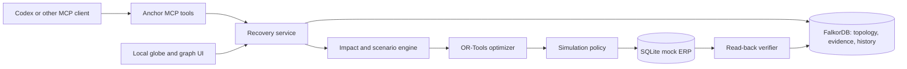

# Anchor

**Recover. Challenge the recovery. Verify.**

Anchor is a graph-native supply-chain recovery agent. It traces hidden shared dependencies in FalkorDB, computes a constrained recovery, stress-tests that plan against bounded follow-on failures, and verifies simulated actions against persistent ERP state.

> All suppliers, contracts, capacities, orders, and disruption events in the demo are synthetic. Anchor's stress report covers only the explicit scenarios it tests; it is not a guarantee against every disruption.

## Install with your AI coding agent

Paste this into Codex CLI from the repository directory:

```text
Read AGENTS.md, Idea.md, rules.txt, and the installation steps in README.md. Check Docker and Python 3.12 or 3.13 first. Start FalkorDB, install Anchor, seed the synthetic demo, and register the local MCP server using the documented Codex command without replacing unrelated configuration. Verify health and tool discovery. Run the Silicon Cascade demo, inject one synthetic reservation rejection, show the rejected receipt and bounded replan, verify the mock ERP read-back, then reduce independent supplier D's capacity and show the recalculated allocation. Explain which outputs are synthetic and which checks passed. Stop and report if a prerequisite is missing; do not silently substitute an in-memory graph.
```

## Manual setup

Requirements: Python 3.12 or 3.13, `uv`, Docker with Compose. Node.js/npm are needed only for the optional dashboard.

```powershell
Copy-Item .env.example .env
docker compose up -d
uv sync --extra dev
uv run anchor reset
uv run anchor serve
```

Anchor binds to loopback by default. MCP is served at `http://127.0.0.1:8765/mcp`; the REST API is served by the same local service. Use `uv run anchor doctor` to inspect prerequisites and readiness. The optional dashboard is not required for the Codex demonstration.

## Codex CLI

```powershell
codex mcp add anchor --url http://127.0.0.1:8765/mcp
codex mcp list
```

Restart Codex CLI after registration if the server's tools do not appear. See `docs/installation.md` for Claude Code, OpenCode, and generic MCP clients; client configurations are version-sensitive.

## Demo: The Silicon Cascade

```text
Use Anchor to investigate the Silicon Cascade scenario. Show the shared upstream paths for the two cheap backups, compute and stress-test a recovery, inject one simulated supplier reservation failure, and execute it in SIMULATION mode. Show the rejected receipt and one bounded replan, then verify the order state by reading it back. Reduce independent supplier D's capacity to 450 units, replan, and show the newly required source.
```

To restore the deterministic baseline, run `uv run anchor reset`. The demo uses a 1,000-unit order, 350 units of synthetic inventory, an initially independent 650-unit source, and a second independent source with at least 200 units. Optimizer outputs are computed from graph state and constraints, not supplier-name rules.

## What makes Anchor different

- FalkorDB paths expose alternatives that share an affected upstream dependency.
- OR-Tools handles integer allocations, source capacities, contracts, and lead times.
- A bounded counterexample loop tests the recovery against single failures and graph-linked correlated pairs, then re-optimizes.
- Actions mutate a persistent local mock ERP; receipts are checked by reading state back. One injected reservation rejection is recorded and triggers at most one new solve and execution attempt.
- Incidents, plans, graph versions, evidence, and verified actions persist in FalkorDB across sessions.

## Architecture and technical details



See `docs/architecture.md`, `docs/product-decision.md`, `docs/research.md`, and `docs/participant-explanation.md` for the architecture, decision rationale, evidence, and implementation walkthrough.

## Verification and benchmark reporting

Run `uv run pytest` for the backend suite. It covers optimizer constraints, mock ERP mutations, MCP tools, and the Silicon Cascade workflow against FalkorDB when it is running. Reproduce the local graph and recovery measurements with `uv run python scripts/benchmark.py`; methodology, machine details, and the bounded synthetic results are in [docs/benchmark-results.md](docs/benchmark-results.md). These are machine-specific prototype measurements, not service-level or business-improvement claims.

To retrieve incidents, plans, actions, and receipts after reopening your coding-agent client, ask it: “Show the latest Anchor recovery history.” The `anchor_history` tool reads a bounded set of records from FalkorDB.

## Research and provenance

Sources, verified dates, competitor comparisons, and the product decision are documented in `docs/research.md` and `docs/product-decision.md`. The project was developed with AI assistance; see `docs/ai-disclosure.md`. Team members should read `docs/participant-explanation.md` and be prepared to explain the implementation.

## Competition

Prepared for **Graph Hacks: Context for AI Agents**, **Track 01 — Agents That Act on Connected Data**, by Team Nexus. Public repository publication and competition submission are separate release actions.

## Limitations

The operational network is synthetic, and simulation mode cannot place real orders or establish real-world supplier capacity. The modeled resilience envelope is finite and deterministic. Live integrations, production procurement, and claims of global operational visibility are out of scope. See `docs/participant-explanation.md` for additional limitations.

## License

MIT. See `LICENSE`.
