# Anchor

[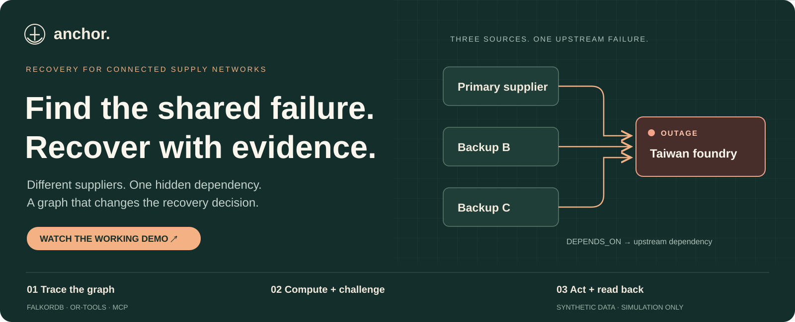](https://www.youtube.com/watch?v=pNqod5FVSlY)

### Find the shared failure. Recover. Test what breaks next.

**Two backup suppliers can have different names and still depend on the same failed foundry.** Anchor follows those dependencies in FalkorDB, computes a feasible recovery, challenges it against bounded follow-on failures, and verifies simulated actions by reading persistent ERP state back.

Built by **Team Nexus** for **Graph Hacks: Context for AI Agents · Track 01 — Agents That Act on Connected Data**.

[Watch the demo](#watch-it-work) · [Web experience](#the-web-experience) · [Database schema](#database-schema) · [Cypher](#the-queries-that-change-the-decision) · [Run locally](#run-locally) · [Reproduce the demo](#reproduce-the-silicon-cascade) · [Technical docs](#technical-documentation)

> **Synthetic network. Simulation-only actions.** All suppliers, facilities, contracts, capacities, inventory, orders, prices, routes, and incidents are fictional. Real city reference points provide geographic context only. A passed stress report covers the declared modeled cases within its bounds.

## Watch it work

**[Play the full narrated demo on YouTube →](https://www.youtube.com/watch?v=pNqod5FVSlY)**

[](https://www.youtube.com/watch?v=pNqod5FVSlY)

Follow the customer order, the foundry outage, the shared supplier paths, the computed plan, and the changed-capacity read-back. The sections below pair explanations with real app screenshots and short source-recording clips. Click a screenshot to open its source clip where linked.

## The web experience

**Explore the network, then follow the recovery.** The globe places the synthetic network in geographic context; the side panels expose the underlying records, and the recovery flow shows the decision and its evidence.

[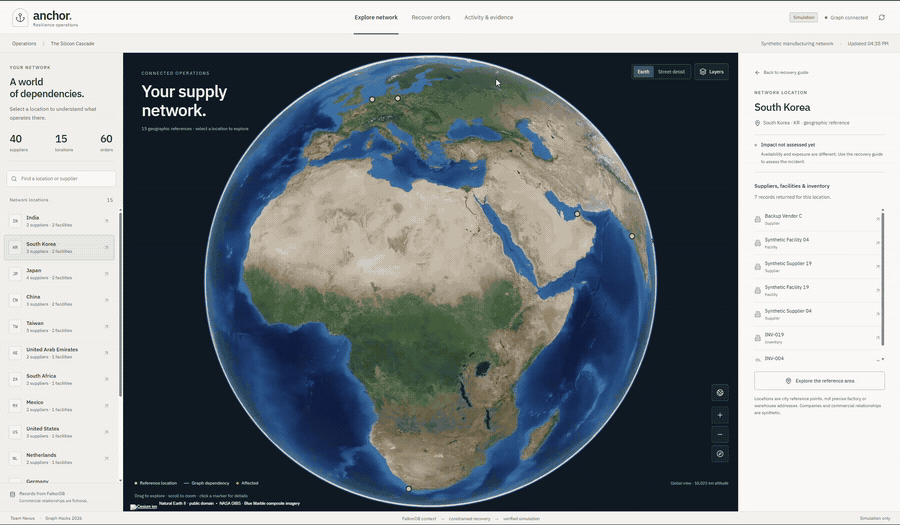](docs/media/web-explorer.mp4)

**[Play the web-view video, 10 seconds, MP4 →](docs/media/web-explorer.mp4)** · [Open the full-resolution globe screenshot](docs/media/network-overview.jpg)

This animated preview is an excerpt from the actual web recording. It preserves the app's geography, dependency lines, side panels, and map attribution. The MP4 provides a sharper, pausable version.

### 1. See the network in context

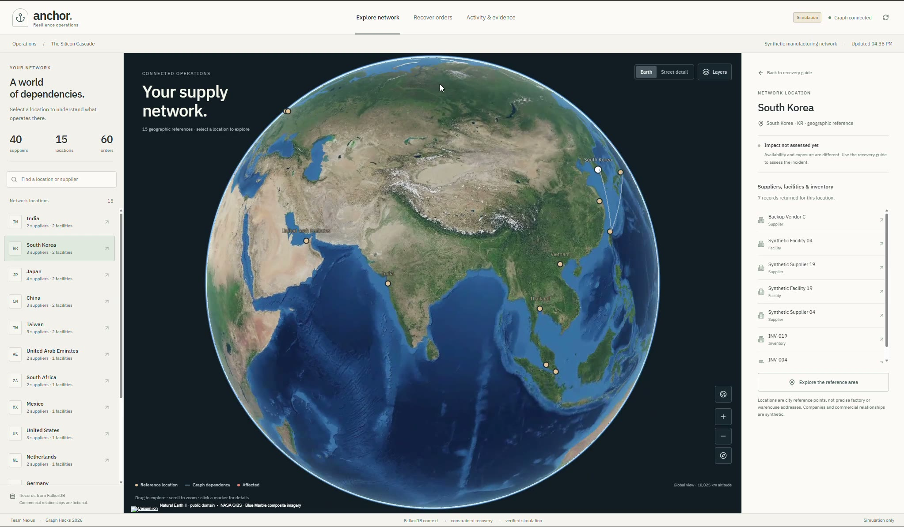

The left panel lists reference locations and the synthetic network's 40 suppliers and 60 orders. The center shows the globe and relationship lines. The right inspector shows the suppliers, facilities, and inventory associated with the selected location. The visible **Graph connected** and **Simulation** indicators establish the local session context.

### 2. Inspect a connected region

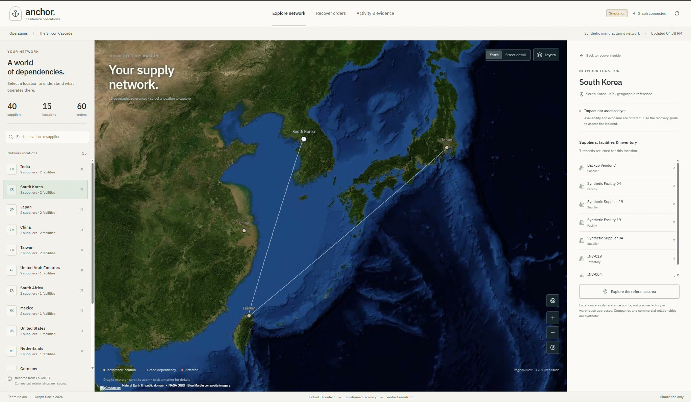

Selecting South Korea reveals the synthetic records associated with that reference location, including Backup Vendor C. The regional view puts the apparent alternatives in context. The backend's returned dependency paths determine eligibility; geographic proximity and a line drawn on a map do not establish supplier independence. The screenshot explicitly shows that impact has not yet been assessed at this stage.

The app also provides **Recover orders** for the guided scenario and **Activity & evidence** for the decision trail. Both use the same backend service as the MCP tools. The captures here show the network explorer. [Map semantics, image sources, and privacy](docs/web-experience.md).

## The Silicon Cascade

A manufacturer needs **1,000 microcontrollers**. It has **350 in inventory**, leaving **650 units to source**. A Taiwan foundry goes down. The primary supplier and two cheap backups all depend on it.

A supplier list makes those backups look usable. Their `DEPENDS_ON` paths make them ineligible. Anchor returns those paths, excludes their capacity, and allocates the remaining demand to an independent supplier. Reduce that supplier's capacity, and the computed allocation changes again.

| Synthetic case | Allocation or proposal | Unmet units | Incremental cost |
|---|---|---:|---:|
| No supplier intervention | 350 inventory | 650 | USD 0 |
| Cheapest proposal ignoring dependencies | 350 inventory + 600 Backup B + 50 Backup C | 650 after graph eligibility is enforced | USD 2,220 nominal |
| Graph-aware recovery | 350 inventory + 650 Independent D | 0 | USD 5,850 |
| D capacity reduced to 450 | 350 inventory + 450 D + 200 Independent E | 0 | USD 6,550 |
| Insufficient eligible capacity | 350 inventory; D, E, and F capacity set to zero | 650, explicitly reported | USD 0 |

Costs are synthetic **USD minor units: 100 minor units = USD 1.00**. The baseline plan returns `incremental_cost_minor: 585000`; the changed-capacity plan returns `655000`. These are computed fixture results, not measured business savings. [Comparison method and benchmark](docs/benchmark-results.md).

## Where the graph does the work

| Decision | FalkorDB's contribution | Observable evidence |
|---|---|---|
| What is affected? | Traverses suppliers that depend on the failed entity and joins their products to orders | Affected order IDs and dependency paths |
| Which suppliers can recover the order? | Joins supply and approved contracts, excluding suppliers with a path to the incident entity | `SHARED_UPSTREAM_PATH_TO_INCIDENT_ENTITY`, path, capacity, approval, and evidence ID |
| What could break the recovery next? | Enumerates relevant failures and shared-upstream pairs; the planner filters them to eligible source IDs | `tested_scenarios`, failed entity IDs, and graph paths |
| Why was this allocation selected? | Supplies qualified candidates and persists the computed plan with its graph version and evidence | Allocations, objective, exclusions, and `anchor_explain_decision` |
| What happened when the agent acted? | Links incidents, plans, actions, evidence, and receipts for later retrieval | `anchor_history` and run-linked receipts; ERP read-back establishes current operational state |

**Changing a relationship changes the decision.** The [dependency-edge integration test](tests/test_graph_integration.py) removes Backup B's upstream dependency and checks that it becomes selectable. If FalkorDB is unavailable, graph-dependent operations fail clearly; Anchor does not substitute an in-memory topology.

The host coding agent interprets the operator's request and selects MCP tools. **FalkorDB and application code supply the operational facts; OR-Tools computes the quantities.** Anchor's backend does not call an LLM API or ask a model to invent a recovery allocation.

### Read the path witness

[](docs/media/paths.mp4)

**[Play the recorded path excerpt →](docs/media/paths.mp4)**

All three supplier paths end at the same failed foundry. This makes the cheaper alternatives exposed to the incident even when their individual supplier records still look available and contract-approved. The returned path is the inspectable reason for excluding their capacity.

The CLI images on this page are recorded Codex summaries. They come from separate rehearsals, with different incident and plan IDs. The [media provenance notes](docs/media/README.md) identify source times, crops, and receipt qualifications. Use fresh IDs when reproducing the demo.

## Database schema

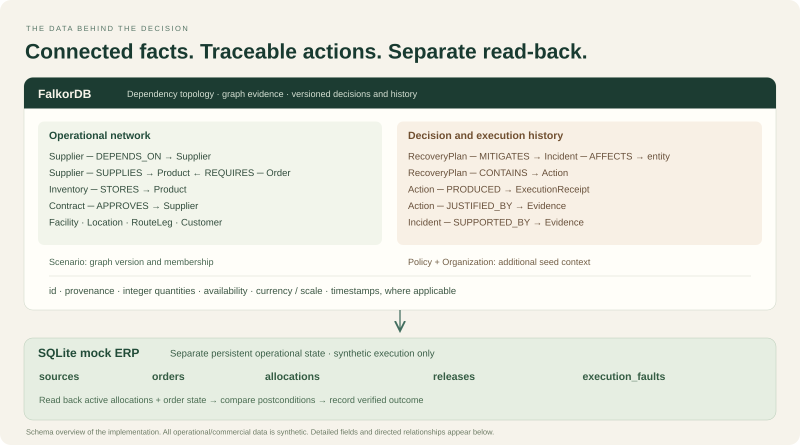

**Why two stores?** FalkorDB answers what depends on what, which sources qualify, and why a plan exists. SQLite represents the operational system that must persist the simulated reservations. Verification reads that separate operational state and compares it to the intended allocation. A stored plan or a success-shaped message alone does not establish that an allocation exists.

### Graph model

This is a decision-relevant slice of the synthetic network. **`DEPENDS_ON` points from a supplier to its upstream dependency**, rather than in the direction of physical material flow.

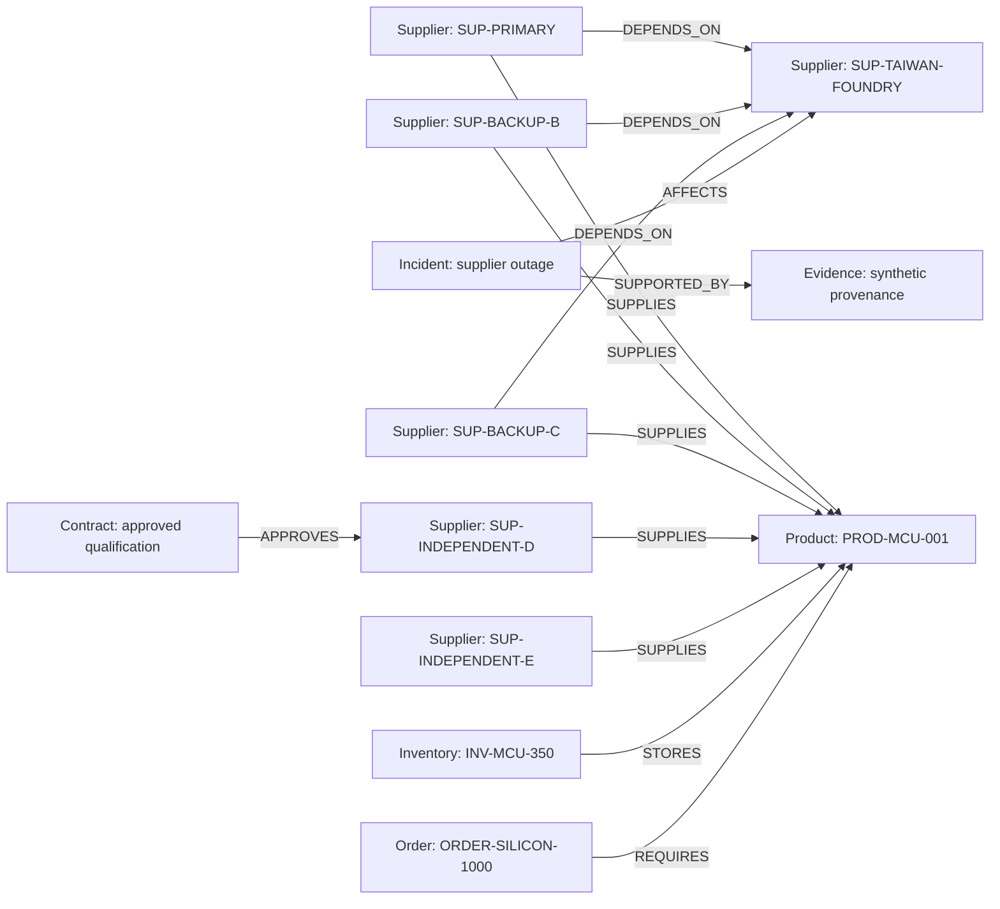

The `SUPPLIES` edges describe nominal capability. A supplier can retain its own available/approved flags while an upstream path makes its capacity unusable for this incident. The exclusion path is the reason for the decision.

| Part of the model | Nodes and directed relationships |
|---|---|
| Dependencies and supply | `Supplier → DEPENDS_ON → Supplier`; `Supplier → SUPPLIES → Product` |
| Manufacturing and geography | `Supplier → OPERATES → Facility`; `Facility → PRODUCES → Product`; `Facility → REQUIRES_INPUT → Product`; `Facility → LOCATED_AT → Location` |
| Inventory and demand | `Inventory → STORES → Product`; `Inventory → HELD_AT → Facility`; `Order → REQUIRES → Product`; `Order → DELIVERED_TO → Customer` |
| Qualification and routes | `Contract → APPROVES → Supplier`; `RouteLeg → STARTS_AT / ENDS_AT → Location` |
| Decisions and evidence | `Incident → AFFECTS → entity`; `Incident → SUPPORTED_BY → Evidence`; `RecoveryPlan → MITIGATES → Incident`; `RecoveryPlan → CONTAINS → Action`; `Action → JUSTIFIED_BY → Evidence`; `Action → PRODUCED → ExecutionReceipt` |

`Scenario` versions the operational graph, with `IN_SCENARIO` links where applicable; `Policy` and `Organization` provide additional seed context. Stable application IDs, integer quantities, units, price scale, provenance, and timestamps make records auditable. The wider fixture includes 40 suppliers and 60 orders, but **the end-to-end planner currently targets the Silicon Cascade order**. It does not optimize the entire displayed network. [Full graph model](docs/graph-model.md) · [Seed implementation](src/anchor/seed.py).

<details>
<summary><strong>Explore all graph node types and their key properties</strong></summary>

FalkorDB is a property graph. This table describes implemented record fields, rather than a relational DDL schema. Fields differ by entity type; complex plan fields are serialized as JSON properties for persistence and decoded on retrieval.

| Label | Key properties | Purpose |
|---|---|---|
| `Supplier` | `id`, `name`, `country`, `capacity`, `available`, `unit_price_minor`, `lead_days` | Synthetic source and upstream dependency |
| `Facility` | `id`, `name`, `country`, `capacity`, `available`, `unit` | Synthetic manufacturing site |
| `Product` | `id`, `name`, `unit`, `compatible_products` | What a source can supply and an order requires |
| `Inventory` | `id`, `facility_id`, `product_id`, `quantity`, `reserved`, `unit` | Stock usable by the recovery |
| `Order` | `id`, `product_id`, `quantity`, `priority`, `due_days`, `status`, `scenario_id` | Customer demand and its constraints |
| `Customer` | `id`, `name`, `country` | Demand destination |
| `Location` | `id`, `name`, `country`, `lat`, `lon`, `source` | City reference point with GeoNames provenance |
| `Contract` | `id`, `supplier_id`, `status`, `effective`, `expires` | Qualification record; the current source query checks approval status |
| `RouteLeg` | `id`, `start_location_id`, `end_location_id`, `capacity`, `available`, `lead_days` | Wider-network route context; full route optimization is not implemented |
| `Incident` | `id`, `scenario_id`, `entity_id`, `incident_type`, `severity`, `mode`, `graph_version`, `status` | Versioned synthetic disruption |
| `Evidence` | `id`, `kind`, `source`, `verified`, `description` | Provenance of modeled facts |
| `RecoveryPlan` | `id`, `incident_id`, `graph_version`, `allocations`, `objective`, `excluded_sources`, `unmet_by_order`, `tested_scenarios`, `worst_counterexample`, `stress_passed`, `stress_iterations` | Computed decision and bounded stress result |
| `Action` | `id`, `plan_id`, `incident_id`, `source_id`, `order_id`, `quantity`, `allocation_json`, `status` | Planned allocation and execution outcome |
| `ExecutionReceipt` | `id`, `action_id`, `run_id`, `idempotency_key`, `source_id`, `order_id`, `quantity`, `status`, `detail` | Run-linked result and ERP receipt reference |
| `Scenario` | `id`, `name`, `version`, `description` | Dataset context and stale-plan guard |
| `Policy` | `id`, `mode`, `allow_mutations`, `source` | Simulation policy record |
| `Organization` | `id`, `name`, `country` | Additional synthetic network context |

The relationship table above describes supported graph templates. Runtime plan persistence creates `MITIGATES` and `CONTAINS` links; receipt persistence creates `PRODUCED` links when an action is associated. Additional schema templates are not evidence that every possible relationship is populated in every run.

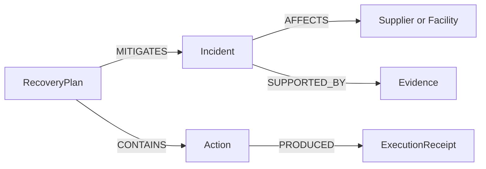

</details>

<details>
<summary><strong>Explore the persistent mock ERP schema</strong></summary>

The SQLite tables below are created in [src/anchor/erp.py](src/anchor/erp.py). Source availability, nonnegative capacity and price, positive allocation quantities, foreign keys, and unique idempotency keys are enforced at the storage boundary. Application validation also checks product, capacity, current price/lead time, and remaining order demand.

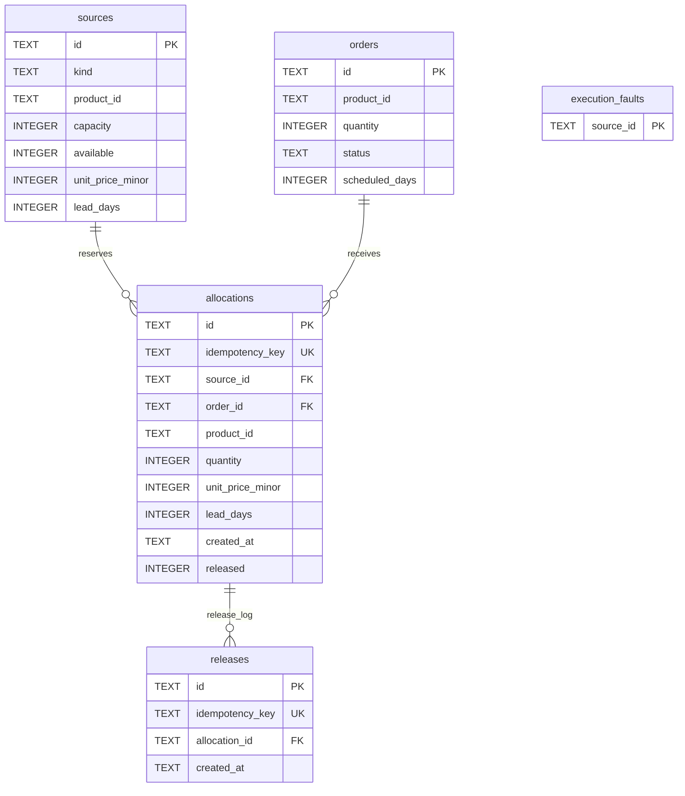

`sources.kind` is either `inventory` or `supplier`. A partial unique index permits only one active allocation per source/order pair. Released allocations remain in the ledger; current-state read-back returns active allocations. `execution_faults` records a one-time synthetic reservation rejection for the fault-injection demo; it has no declared foreign key.

</details>

## The queries that change the decision

Queries live in [src/anchor/graph.py](src/anchor/graph.py). Values are parameters; relationship types and labels come from internal templates. MCP tools do not accept arbitrary Cypher.

**1. Trace downstream exposure through upstream dependency paths.** The template supports up to 12 hops, with the caller's bounded depth applied and an explicit result limit. The demo's primary and backup paths are one hop each; the traversal supports deeper paths.

```cypher
MATCH (root {id: $entity_id})
MATCH p=(n)-[:DEPENDS_ON*1..12]->(root)
WHERE length(p) <= $max_depth
RETURN DISTINCT n.id AS id, labels(n) AS labels, n.name AS name,
       length(p) AS depth, [x IN nodes(p) | x.id] AS path
LIMIT $limit
```

**2. Return the witness for excluding an apparently usable supplier.** This is the query used by `GraphStore.dependency_exclusions`:

```cypher
MATCH (i:Incident {id: $id})-[:AFFECTS]->(failed)
MATCH (o:Order)-[:REQUIRES]->(p:Product)
WHERE o.scenario_id = i.scenario_id
MATCH (s:Supplier)-[sp:SUPPLIES]->(p)
MATCH path=(s)-[:DEPENDS_ON*1..12]->(failed)
OPTIONAL MATCH (c:Contract)-[:APPROVES]->(s)
RETURN DISTINCT s.id, s.name, p.id, s.capacity, s.available,
       sp.capacity, sp.available, c.status,
       [x IN nodes(path) | x.id] AS path
LIMIT 500
```

For the foundry outage, these paths explain why Primary, Backup B, and Backup C are excluded. The separate source-qualification query retains candidates with no path to the failed entity (`path IS NULL`) and an approved contract. The optimizer then enforces product compatibility, availability, capacity, and due-date constraints on those candidates.

Shared-upstream queries also discover supplier pairs with a common dependency for bounded scenario generation. Anchor uses bounded Cypher traversal, not PageRank or centrality procedures. [Additional Cypher and algorithm notes](docs/cypher-queries.md) · [Optimizer formulation](docs/optimization.md).

## Architecture

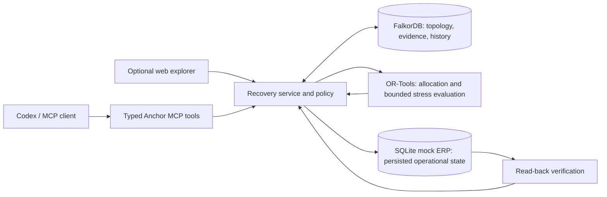

The same service powers MCP and REST. FalkorDB owns the connected scenario and decision history; SQLite represents the separate operational system whose allocations must actually change. A plan captures the graph version, and execution rejects a stale version. This is a local simulation guard, not a distributed transaction guarantee.

**Stack:** Python 3.12/3.13 · FalkorDB · OR-Tools CP-SAT · FastAPI · FastMCP · SQLite · optional TypeScript/React web explorer. [Architecture](docs/architecture.md) · [API contract](docs/api-contract.md).

### How a plan becomes an action

1. **Discover:** the MCP client asks for the scenario and affected orders. FalkorDB returns typed records and explicit paths.
2. **Qualify:** the service resolves eligible supply and inventory. A dependency path to the failed source excludes exposed supply; qualification is enforced before optimization.
3. **Allocate:** OR-Tools minimizes weighted current shortfall, modeled single-failure shortfall, modeled pair-failure shortfall, incremental cost, then supplier changes, in that order. Each optimum is fixed before solving the next objective.
4. **Challenge:** the evaluator tests the declared additional failures and adds a worst counterexample when it exposes a loss. It reports unresolved demand when the candidate cannot meet the modeled requirements within its bounds.
5. **Execute:** the service checks simulation mode and graph version, reconciles active mock reservations, and applies allowed changes with idempotency handling.
6. **Verify:** the service reads active ERP allocations and order state, checks the requested postconditions, and records receipts and outcomes in FalkorDB.

### The MCP interface

These tools are the agent's working interface. Each has a bounded domain purpose; none exposes arbitrary shell commands, SQL, or Cypher.

| Tool | What the operator gets |
|---|---|
| `anchor_health` | Graph connectivity and simulation readiness |
| `anchor_network_summary` | Network counts, bounded entity/edge records, geography, and recent incidents |
| `anchor_reset_demo` | A clean synthetic graph and mock ERP baseline; destructive to prior demo state |
| `anchor_trigger_incident` | A new incident ID and versioned outage state |
| `anchor_assess_cascade` | Affected orders and graph paths explaining exposure |
| `anchor_find_recovery_plans` | Computed allocation, costs, unmet demand, exclusions, and bounded stress result |
| `anchor_explain_decision` | Persisted plan and graph evidence, including after a service restart |
| `anchor_execute_recovery` | Simulation execution receipts and result; `max_replans=0` stops after the first attempt |
| `anchor_verify_recovery` | Current persisted ERP allocations, order state, and remaining shortfall for the run's orders |
| `anchor_modify_simulation` | An allowlisted synthetic supplier-capacity change |
| `anchor_modify_dependency` | A validated supplier-edge change that increments graph version |
| `anchor_inject_simulated_failure` | One rejected future supplier reservation for a controlled failure demonstration |
| `anchor_history` | Recent persisted incidents, plans, actions, and receipts |

[Exact input schemas and client support](docs/mcp-tools.md) · [Tool implementations](src/anchor/app.py).

## Run locally

Requirements: **Python 3.12 or 3.13**, **uv**, and **Docker with Compose v2**. The optional web explorer also needs **Node.js 22.18 or newer and npm**. No LLM API key or paid operational service is required by the backend; an MCP client supplies the agent interface.

Clone the public repository and open a terminal in its root:

```powershell
git clone https://github.com/ChristopherJoshy/Anchor-GraphHacks.git
```

Then install and start the local services:

```powershell
Copy-Item .env.example .env
docker compose up -d
uv sync --extra dev
uv run anchor reset
uv run anchor doctor
uv run anchor serve
```

Copy `.env.example` only when creating a new local configuration. **`anchor reset` deletes and recreates the configured synthetic demo graph and local mock ERP state**, including prior demo history and allocations. Wait for FalkorDB to become healthy before resetting. If `anchor doctor` does not report readiness, resolve that failure before running the demo.

| Local endpoint | Purpose |
|---|---|
| `http://127.0.0.1:8765/mcp` | Streamable HTTP MCP server |
| `http://127.0.0.1:8765/api/health` | REST readiness report |
| `http://127.0.0.1:3000` | FalkorDB browser from the Compose image |
| `http://127.0.0.1:5173` | Optional web explorer |

Services bind to loopback by default. The local API/MCP server is unauthenticated and is not intended for public exposure. Stop the backend with Ctrl+C and stop FalkorDB with `docker compose down`, which preserves its named volume. [Installation, other MCP clients, and cleanup](docs/installation.md).

### Connect Codex

With the backend running, register Anchor from another terminal if it is not already registered:

```powershell
codex mcp add anchor --url http://127.0.0.1:8765/mcp
codex mcp list
```

Restart the client if its tool schema is stale. Confirm it discovers `anchor_execute_recovery` with the `max_replans` parameter before recording. Codex CLI was exercised locally; Claude Code and OpenCode setup examples are documented but those clients have not been exercised.

### Optional web explorer

Keep the backend running, then start the UI in another terminal:

```powershell
npm --prefix web ci
npm --prefix web run dev
```

Open `http://127.0.0.1:5173` and choose **Recover orders** to follow the guided scenario. The globe reads the same local API and graph. NASA imagery and OpenStreetMap tiles require internet access; bundled low-detail Earth imagery provides an overview when remote imagery cannot load. City markers are geographic references, not exact supplier sites. [Map behavior, attribution, and privacy](docs/web-experience.md).

## Reproduce the Silicon Cascade

Use the following prompts in a connected coding-agent client. **Keep the incident, plan, and run IDs returned by this session; never reuse example IDs after a reset.** No production action is supported.

**1. Reset and check the baseline.**

```text
Use only Anchor MCP tools and SIMULATION mode. Reset the named synthetic demo,
then check health and the network summary. SUP-TAIWAN-FOUNDRY must be available
with capacity 1000; ORDER-SILICON-1000 must be OPEN for 1000 units;
INV-MCU-350 must have quantity 350 and reserved 0. Stop if any check fails.
```

**2. Follow the graph and compute the plan.**

```text
Trigger SUPPLIER_OUTAGE for SUP-TAIWAN-FOUNDRY in SCENARIO-SILICON-CASCADE,
using SIMULATION mode. Use the returned incident ID to assess the cascade.
Show affected orders and paths for SUP-PRIMARY, SUP-BACKUP-B, and SUP-BACKUP-C.
Find a recovery plan and show allocations, unmet demand, cost with currency
and minor-unit scale, excluded suppliers with path witnesses, tested scenarios,
worst counterexample, and stress iterations. Explain the persisted decision.
```

Expected baseline allocation: **350 inventory + 650 D**, **USD 5,850**, **0 unmet units**. Primary and both apparent backups carry the exclusion reason `SHARED_UPSTREAM_PATH_TO_INCIDENT_ENTITY`.

[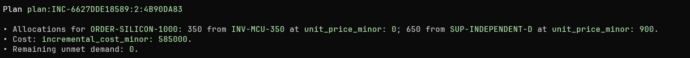](docs/media/plan.mp4)

**[Play the baseline planning excerpt →](docs/media/plan.mp4)**. Here `585000` is USD 5,850 at 100 minor units per USD. This crop demonstrates a candidate allocation; execution and verification are separate steps.

**3. Execute once and read the state back.**

```text
Execute only the plan just returned, once, in SIMULATION mode with max_replans=0.
Do not retry or replan after failure. If a run ID is returned, verify that run.
Show receipts, persisted read-back allocations, order status, and remaining
shortfall. Distinguish APPLIED actions from DUPLICATE existing allocations.
```

On a fresh baseline, expect 350 inventory and 650 D allocated to `ORDER-SILICON-1000`, with zero shortfall and the order scheduled at 9 days. `ALLOCATED` is a simulated reservation state, not a claim of physical delivery.

[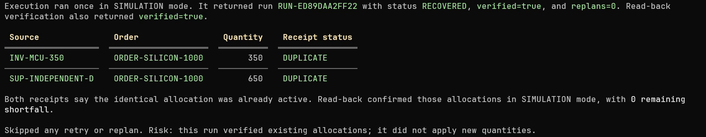](docs/media/execution.mp4)

**[Play the execution-summary excerpt →](docs/media/execution.mp4)**. This recorded run confirmed already-active allocations: both receipts are `DUPLICATE`. It demonstrates idempotency and read-back of an existing state. It did not apply fresh quantities in that run.

**4. Change capacity and recompute for the same incident.**

```text
Use anchor_modify_simulation to set SUP-INDEPENDENT-D capacity to 450 with
kind="supplier_capacity". Replan for the same incident using a newly returned
plan ID. Show the computed allocation and cost. Execute that plan once in
SIMULATION mode with max_replans=0; stop on failure. If it returns a run ID,
verify it and show read-back allocations and remaining shortfall.
```

Expected revised allocation: **350 inventory + 450 D + 200 E**, **USD 6,550**, **0 unmet units**, scheduled at **12 days**. An unchanged inventory allocation can return `DUPLICATE`; that confirms an existing allocation rather than a new write. Changed supplier reservations are released and replaced as needed. Always inspect the final read-back state.

[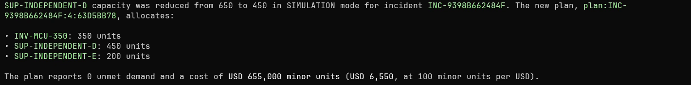](docs/media/changed-plan.mp4)

**[Play the changed-capacity planning excerpt →](docs/media/changed-plan.mp4)**. Losing 200 units of D's capacity makes the solver select 200 units from E. The source prices make the resulting incremental cost USD 6,550.

[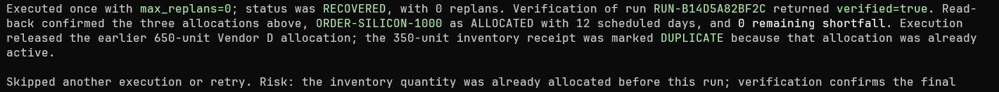](docs/media/readback.mp4)

**[Play the read-back excerpt →](docs/media/readback.mp4)**. The changed-capacity run released the earlier 650-unit D reservation and confirmed the final 350 + 450 + 200 mix. The inventory reservation stayed active and returned a duplicate receipt. Read-back reported the order `ALLOCATED`, 12 scheduled days, and no remaining shortfall.

For a separate rejection demonstration, `anchor_inject_simulated_failure` rejects one future supplier reservation. Execution permits at most one automatic replan when explicitly using `max_replans=1`; this is distinct from stress-test counterexample iterations. [Full recording runbook](docs/pitch-and-recording-guide.md) · [Demo checklist](docs/demo-script.md) · [All MCP tools](docs/mcp-tools.md).

## What the stress result means

Anchor solves an integer allocation, evaluates deterministic additional failures, and adds the worst uncovered counterexample to the optimization until no loss remains in the enumerated cases or its iteration bound is reached. Scenario recourse can use only unused capacity after surviving allocations.

Read the returned `tested_scenarios`, `stress_passed`, `worst_counterexample`, `stress_iterations`, assumptions, and residual demand together. **`stress_iterations: 0` means no counterexample was added to the solve; listed scenarios are still evaluated.** The MCP iteration bound defaults to 8 and is capped at 16. A zero correlated-pair shortfall is meaningful only alongside the scenario list; it does not establish that every possible pair was tested.

The recorded rehearsal lists **seven modeled scenarios**. The earlier [benchmark snapshot](docs/benchmark-results.md) reports nine; use each run's returned list rather than treating either count as a universal constant. The flagship single-order demo shows shared-dependency exclusions and capacity-driven replanning. A separate [optimizer test](tests/test_optimizer.py), `test_graph_derived_counterexample_changes_priority_allocation`, demonstrates a path-bearing counterexample changing scarce-source allocation across priority orders.

## Verification and evidence

With FalkorDB running, use a second terminal:

```powershell
uv run pytest
uv run ruff check src tests scripts
uv run python scripts/benchmark.py
```

The suite covers graph-backed source eligibility, dependency changes, optimizer constraints, simulation policy, ERP persistence and idempotency, stale plans, MCP schemas, bounded replanning, and read-back verification. **FalkorDB integration tests skip when the graph is unavailable**; check the test summary before claiming a complete integration pass. Integration tests use separate named graphs and temporary ERP files.

The benchmark creates its own uniquely named graph and temporary ERP, checks allocation changes, measures graph/planning/end-to-end operations, then removes its graph. It does not reset `anchor_demo`. Recorded results are dated, machine-specific prototype measurements with methodology and sample counts in [benchmark-results.md](docs/benchmark-results.md); no production latency or business improvement is claimed.

The [demo evidence and media notes](artifacts/demo/README.md) distinguish actual recordings from editorial diagrams, disclose duplicate receipts and source-run differences, and document AI narration and asset credits. Video production sources are included; generated footage and media dependencies are local artifacts rather than a reproducible product-install requirement.

## Technical documentation

| Read this | For |
|---|---|
| [Installation](docs/installation.md) / [MCP tools](docs/mcp-tools.md) | Prerequisites, client setup, tool inputs, and effects |
| [Graph model](docs/graph-model.md) / [Cypher](docs/cypher-queries.md) | Node/edge semantics and bounded queries |
| [Architecture](docs/architecture.md) / [Optimization](docs/optimization.md) | Service responsibilities, constraints, objectives, and stress evaluation |
| [API contract](docs/api-contract.md) / [Security](docs/security.md) | REST boundary, validation, and execution safety |
| [Participant explanation](docs/participant-explanation.md) | Implementation walkthrough and technical questions |
| [Product decision](docs/product-decision.md) / [Research](docs/research.md) | Scope, alternatives, dated evidence, and rationale |
| [Benchmark](docs/benchmark-results.md) / [Limitations](docs/limitations.md) | Recorded measurements and supported claims |
| [AI disclosure](docs/ai-disclosure.md) / [Demo provenance](artifacts/demo/README.md) | Coding assistance, media tools, attribution, and review responsibilities |

Implementation entry points: [graph queries](src/anchor/graph.py), [orchestration](src/anchor/service.py), [optimizer](src/anchor/optimizer.py), [mock ERP](src/anchor/erp.py), [MCP/REST tools](src/anchor/app.py), and [web explorer](web/src/App.tsx).

## Scope and limitations

- One synthetic target order is optimized end to end. The wider network supports graph traversal and visualization; full multi-order production/BOM propagation is not implemented.
- Hard qualification and feasibility checks run in code. Stress tests cover finite deterministic cases, with no inferred failure probabilities or universal resilience guarantee.
- Execution changes a local mock ERP. Real procurement, payments, logistics, and production writes are outside the product boundary.
- Graph and ERP updates are not one distributed transaction. General compensation, multi-process concurrency, and production authentication remain out of scope.
- Plans use one currency and minor-unit scale; currency conversion is not implemented. Receipts and current-state read-back must be interpreted separately from an immutable historical snapshot.

## Team, disclosure, and license

> **A note from Christopher:** Made with the help of Codex. I designed the graph schema and built the MCP layer; Codex built the web view with my direction. Anchor came together in approximately eight hours, fitted around my exam commitments.

**Team Nexus · Track 01 — Agents That Act on Connected Data.** The [official Graph Hacks rules](https://www.wemakedevs.org/hackathons/falkordb/rules) specify the submission requirements. The repository includes local setup, the graph model, essential queries, and a linked demo; these materials do not assert that a competition submission has been completed.

Codex assisted with research, design, implementation, verification, documentation, and demo production. The backend's runtime behavior remains deterministic code plus FalkorDB; the connected client handles natural-language tool selection. Team members remain responsible for reviewing, reproducing, and explaining the work. [Full AI disclosure](docs/ai-disclosure.md).

Released under the **MIT License**. See [LICENSE](LICENSE). Media and bundled third-party assets retain their own licenses and credits in the [demo notes](artifacts/demo/README.md) and [map documentation](docs/web-experience.md).
