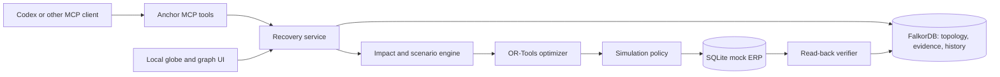

# Anchor

**Find the shared failure. Recover. Test what breaks next.**

Anchor is a graph-native recovery agent for interconnected supply networks. It uses FalkorDB to find when apparent backups share the same upstream failure, computes a feasible allocation, challenges it with a bounded set of follow-on failures, and verifies simulated actions against persistent ERP state.

> All suppliers, contracts, capacities, orders, and disruption events in the demo are synthetic. Anchor's stress report covers only the explicit scenarios it tests; it is not a guarantee against every disruption.

**The decision Anchor is built to change:** two backup suppliers can have different names and still depend on the same failed factory. Anchor follows those paths, removes compromised capacity from the feasible plan, then shows which allocation survives the modeled cases and what it costs.

## Install with your AI coding agent

Paste this into Codex CLI from the repository directory:

```text
Read AGENTS.md, Idea.md, rules.txt, and the installation steps in README.md. Check Docker and Python 3.12 or 3.13 first. Start FalkorDB, install Anchor, seed the synthetic demo, and register the local MCP server using the documented Codex command without replacing unrelated configuration. Verify health and tool discovery. Run the Silicon Cascade demo, inject one synthetic reservation rejection, show the rejected receipt and bounded replan, verify the mock ERP read-back, then reduce independent supplier D's capacity and show the recalculated allocation. Explain which outputs are synthetic and which checks passed. Stop and report if a prerequisite is missing; do not silently substitute an in-memory graph.
```

## Manual setup

Requirements: Python 3.12 or 3.13, `uv`, Docker with Compose. Node.js/npm are needed only for the optional dashboard.

```powershell
Copy-Item .env.example .env
docker compose up -d
uv sync --extra dev
uv run anchor reset
uv run anchor serve
```

Anchor binds to loopback by default. MCP is served at `http://127.0.0.1:8765/mcp`; the REST API is served by the same local service. Use `uv run anchor doctor` to inspect prerequisites and readiness. The optional dashboard is not required for the Codex demonstration.

## Codex CLI

```powershell
codex mcp add anchor --url http://127.0.0.1:8765/mcp
codex mcp list
```

Restart Codex CLI after registration if the server's tools do not appear. See `docs/installation.md` for Claude Code, OpenCode, and generic MCP clients; client configurations are version-sensitive.

## Demo: The Silicon Cascade

```text
Use Anchor to investigate the Silicon Cascade scenario. Show the shared upstream paths for the two cheap backups, compute and stress-test a recovery, inject one simulated supplier reservation failure, and execute it in SIMULATION mode. Show the rejected receipt and one bounded replan, then verify the order state by reading it back. Reduce independent supplier D's capacity to 450 units, replan, and show the newly required source.
```

To restore the deterministic baseline, run `uv run anchor reset`. The demo uses a 1,000-unit order, 350 units of synthetic inventory, an initially independent 650-unit source, and a second independent source with at least 200 units. Optimizer outputs are computed from graph state and constraints, not supplier-name rules.

### What the checked-in scenario computes

These are deterministic outputs for the synthetic Silicon Cascade fixture, not measured real-world savings. Costs are synthetic USD; the comparison method and assumptions are in [docs/benchmark-results.md](docs/benchmark-results.md).

| Case | Allocation or proposal | Unmet units | Incremental cost |
|---|---|---:|---:|
| No supplier intervention | 350 inventory | 650 | USD 0 |
| Cheapest, dependency-blind proposal | 350 inventory + 600 backup B + 50 backup C; the graph marks both backups exposed to the failed foundry | 650 after eligibility is enforced | USD 2,220 nominal |
| Graph-optimized recovery | 350 inventory + 650 independent D | 0 | USD 5,850 |
| D capacity reduced to 450 | 350 inventory + 450 D + 200 independent E | 0 | USD 6,550 |

The interesting result is the trade-off: the dependency-blind proposal looks cheaper on paper, but cannot satisfy the order once the shared upstream failure is followed. The graph-aware plan pays more for supply that is actually eligible.

## What makes Anchor different

- **The graph changes the allocation.** FalkorDB paths expose alternatives that share the failed upstream facility; graph eligibility affects which capacity the optimizer may use. A dependency-edge change is also covered by an integration test that verifies the selected strategy changes.
- **The solver allocates, it does not recommend.** OR-Tools handles integer quantities, source capacities, contracts, due dates, and unmet demand. The displayed costs use synthetic USD minor units.
- **The recovery is challenged before execution.** A bounded counterexample loop evaluates single failures and graph-linked correlated pairs. The checked-in Silicon Cascade benchmark passes its nine declared graph-derived scenarios; that result covers only those scenarios and bounds.
- **A success response is not proof of execution.** Actions mutate the persistent local mock ERP. Anchor records receipts and verifies postconditions by reading the ERP state back. A rejected reservation is recorded and triggers at most one replan attempt.
- Incidents, plans, graph versions, evidence, and verified actions persist in FalkorDB across sessions.

The separate optimizer test `test_graph_derived_counterexample_changes_priority_allocation` shows a path-bearing failure scenario changing which order receives a scarce cheap source. The flagship single-order run demonstrates the shared-dependency rejection, the capacity-driven replan, and its declared stress-set result; it does not claim that the run found a counterexample that changed that single-order allocation.

## Why FalkorDB is load-bearing

The graph is used to discover paths from the failed foundry to the apparent backups, determine eligible supply, generate follow-on scenarios, and persist evidence-linked decisions. Removing FalkorDB causes graph-dependent operations to fail clearly. The tests also change a predefined dependency edge and check that recovery changes with it. This is the core product test: if the relationship changes but the decision does not, Anchor has not used the graph to decide.

## Architecture and technical details



See `docs/architecture.md`, `docs/product-decision.md`, `docs/research.md`, and `docs/participant-explanation.md` for the architecture, decision rationale, evidence, and implementation walkthrough.

## Verification and benchmark reporting

Run `uv run pytest` for the backend suite. It covers optimizer constraints, mock ERP mutations, MCP tools, and the Silicon Cascade workflow against FalkorDB when it is running. Reproduce the local graph and recovery measurements with `uv run python scripts/benchmark.py`; methodology, machine details, and the bounded synthetic results are in [docs/benchmark-results.md](docs/benchmark-results.md). These are machine-specific prototype measurements, not service-level or business-improvement claims.

To retrieve incidents, plans, actions, and receipts after reopening your coding-agent client, ask it: “Show the latest Anchor recovery history.” The `anchor_history` tool reads a bounded set of records from FalkorDB.

## Research and provenance

Sources, verified dates, competitor comparisons, and the product decision are documented in `docs/research.md` and `docs/product-decision.md`. The project was developed with AI assistance; see `docs/ai-disclosure.md`. Team members should read `docs/participant-explanation.md` and be prepared to explain the implementation.

## Competition

Prepared for **Graph Hacks: Context for AI Agents**, **Track 01 — Agents That Act on Connected Data**, by Team Nexus. Public repository publication and competition submission are separate release actions.

## Limitations

The operational network is synthetic, and simulation mode cannot place real orders or establish real-world supplier capacity. The modeled resilience envelope is finite and deterministic. Live integrations, production procurement, and claims of global operational visibility are out of scope. See `docs/participant-explanation.md` for additional limitations.

## License

MIT. See `LICENSE`.
