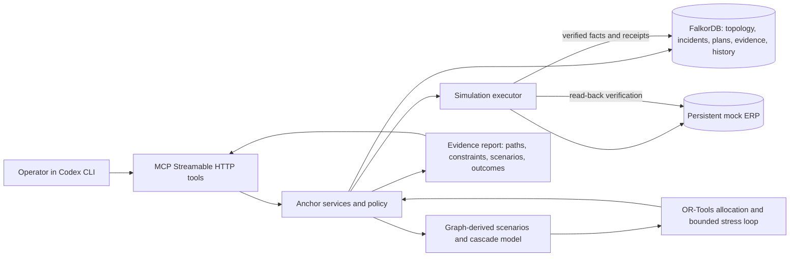

# Anchor architecture

**Status:** Target architecture and behavior contract. This file is not proof that every component is implemented or tested.

## System boundary

Anchor is a local-first, simulation-only decision system. An MCP client (primarily Codex CLI) calls typed domain tools. The backend owns validation, graph queries, deterministic simulation, optimization, policy, and execution orchestration. FalkorDB is the source of connected operational scenario state and graph-linked evidence/history. A local persistent mock ERP represents mutable operational state for the demo. No real procurement or production connector is in scope.

## Responsibilities and authority

- **MCP/API boundary:** typed requests, bounded outputs, actionable error codes. Never accepts arbitrary Cypher or shell/SQL instructions.
- **Domain services:** validate incident context, coordinate graph reads and writes, call simulator/solver, enforce state/version preconditions, and assemble evidence.
- **FalkorDB:** primary dependency graph, scenario-specific topology and state, graph traversal, correlated upstream discovery, evidence paths, scenario/plan/action/receipt linkage, and persistent history. Graph-down behavior is a clear error for graph-dependent work.
- **Cascade model:** deterministic propagation of synthetic supply capacity and unmet order demand using declared BOM, units, time buckets, and resource conservation assumptions.
- **Optimizer:** OR-Tools constrained allocation. Hard eligibility and authorization rules are enforced as constraints. A lexicographic objective gives priority to unmet demand, then tested follow-on failure loss, then incremental cost and operational change burden. Exact integer weights/scales must be documented with the implemented formulation.
- **Counterexample loop:** build a bounded explicit scenario set using FalkorDB relationships: relevant supplier/facility/route failures and selected correlated pairs connected by shared upstream dependencies. Solve candidate, evaluate its recourse/outcomes against each scenario, select the worst uncovered failure, add it to the robust constraint set, and solve again. Stop on no material counterexample, infeasibility, or a fixed iteration cap. Persist the full set and stop reason.
- **Policy and executor:** default SIMULATION only; validate mode, authorization, graph snapshot/version and current mock ERP state; make idempotent state changes; bound retries and re-plans; persist receipts; verify by reading ERP state. Failed or irreversible-in-simulation actions are not mislabeled as rolled back.
- **History/explanation:** attach decisions and results to graph entity paths and evidence IDs, so a later MCP call can recover context after client restart.

## Graph model

Represent fictional operational entities explicitly: `Supplier`, `Facility`, `Product`, `Inventory`, `Order`, `Customer`, `Location`, `RouteLeg`, `Contract`, `Incident`, `Evidence`, `Scenario`, `RecoveryPlan`, `Action`, and `ExecutionReceipt`. Relationships express supply, production, required inputs, supplier/facility dependency, storage, order demand, approval, route continuity, incident effect, mitigation, contained actions, evidence support, and execution provenance. Use stable application IDs; integer quantities and integer minor-currency values; explicit units, currency, source, verification, validity/effective times, and scenario membership where relevant.

Keep real geographic reference locations distinct from synthetic entities and commercial relationships. For the demo, all supplier ownership, facilities, capacities, contracts, prices, production relationships, inventory, orders, routes, and incidents are synthetic unless a source and license are explicitly recorded.

Operational graph state needs a monotonically increasing scenario version. A plan records the version and relevant constraints it used. Before execution, reject or revalidate stale plans. Version checking must cover the demonstrated local concurrency model; do not claim distributed transaction guarantees.

## Key graph operations

Use fixed parameterized Cypher templates for:

1. Bounded downstream impact traversal from an incident-affected supplier or facility to products, facilities, orders, and customers.
2. Shared upstream dependency intersection between a failed source and apparent alternatives, with explicit returned paths.
3. Qualification of alternate suppliers/facilities, joining product compatibility, contract approval, availability, effective dates, and route feasibility.
4. Failure scenario generation around relevant shared upstream nodes/edges.
5. Evidence paths for allocations, exclusions, counterexamples, action records, and prior incidents.
6. Version-checked graph persistence and retrieval of plans, actions, and verified outcomes.

Do not use arbitrary model-generated Cypher. Verify each query and any `algo.*` procedure against the selected FalkorDB server version. If procedures are unavailable, use a correct bounded Cypher traversal and describe the fallback accurately.

## Stress-test meaning

The bounded evaluator is a deterministic scenario test, not a probability model. A result should include: scenario IDs and failed entities; graph-derived paths; assumptions and scope; demand by order; recourse or unmet quantity; cost; graph snapshot version; iteration count; and termination reason. “No counterexample found” means none was found in the enumerated set within the stated bounds. It does not mean no other failure can defeat the plan.

## Execution truth

The mock ERP is independently mutable persistent state, not an output renderer. A successful action requires a validated request, policy pass, idempotency handling, actual state mutation, receipt persistence, and postcondition read-back. If read-back disagrees, status remains failed or needs review; graph history records the mismatch. Graph and ERP updates are not assumed to be one atomic distributed transaction, so the orchestrator must represent partial success and compensation limits honestly.

## Failure behavior

Return explicit errors for FalkorDB unavailable, missing or stale graph data, invalid quantities/units, ineligible sources, no feasible allocation, stress bound reached, stale plan, duplicate request, ERP rejection/timeout, verification mismatch, and exhausted retry/replan budget. Missing evidence is not treated as zero risk. Never return a fabricated plan from model knowledge when graph-dependent queries fail.
